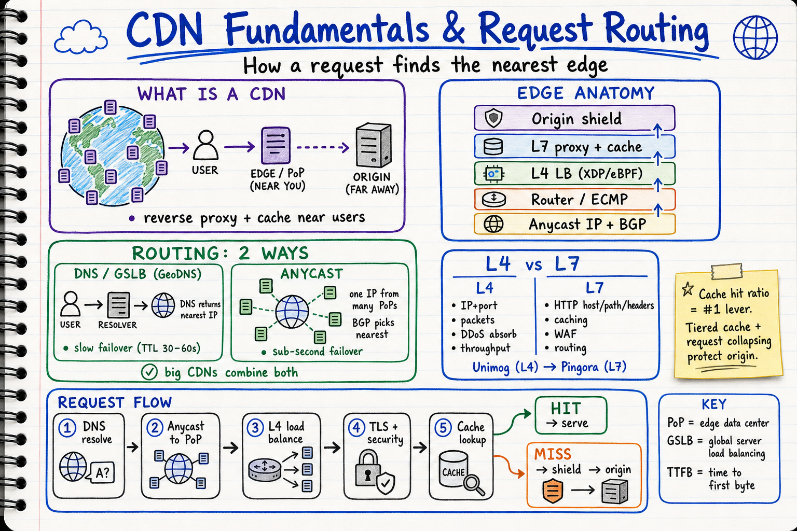
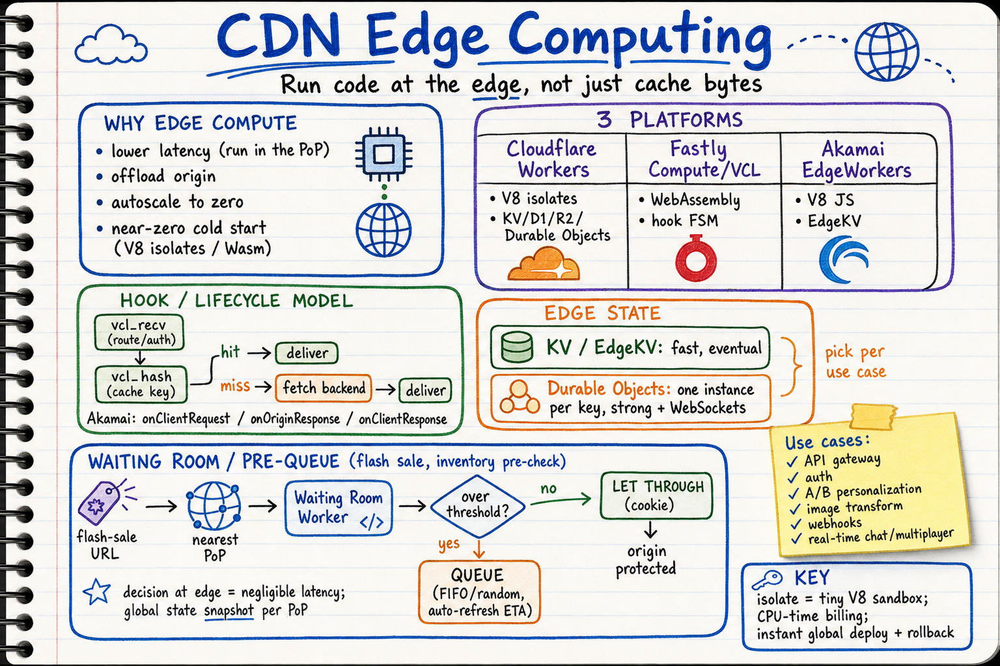
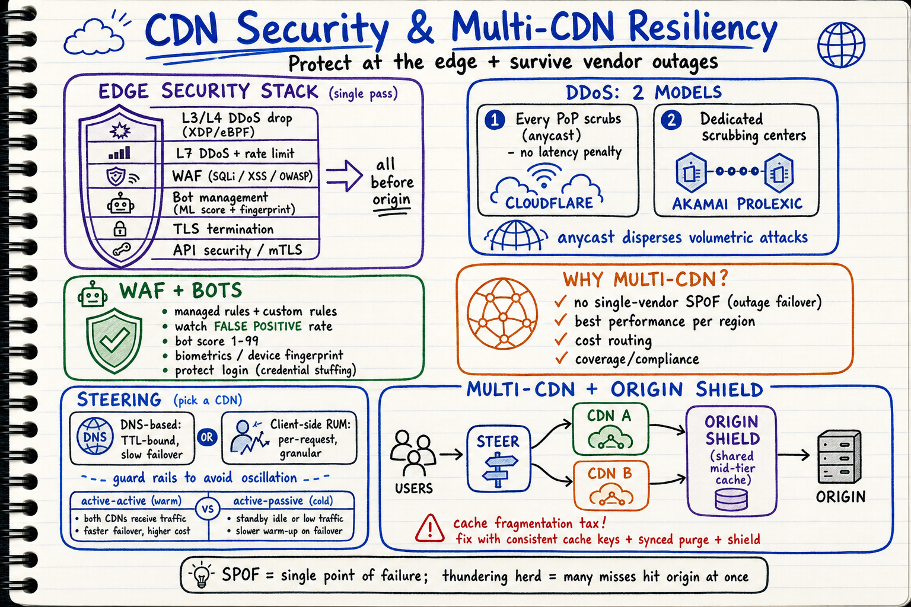

# CDN Visual Notes

Sketchbook-style visual learning notes for **Content Delivery Networks (CDNs)** and edge platforms, based on engineering material from Cloudflare, Akamai, and Fastly.

Each topic has **two parts**:
- a **summary diagram** (`.png`) — the quick, visual sketchbook overview, and
- a **detailed markdown** (`.md`) — the in-depth reference with source links.

| Topic | Summary diagram | Detailed notes |
| --- | --- | --- |
| CDN fundamentals & request routing | `cdn-architecture-request-routing-sketchbook.png` | [`01-cdn-fundamentals-and-request-routing.md`](./01-cdn-fundamentals-and-request-routing.md) |
| CDN edge computing | `cdn-edge-compute-sketchbook.png` | [`02-cdn-edge-computing.md`](./02-cdn-edge-computing.md) |
| CDN security & multi-CDN resiliency | `cdn-security-multicdn-sketchbook.png` | [`03-cdn-security-and-multi-cdn-resiliency.md`](./03-cdn-security-and-multi-cdn-resiliency.md) |

## Diagrams

### 1. CDN Fundamentals & Request Routing

Detailed notes: [`01-cdn-fundamentals-and-request-routing.md`](./01-cdn-fundamentals-and-request-routing.md)

Covers:
- **What a CDN is**: global reverse-proxy cache in front of origin; the "middle mile" problem
- **Edge anatomy**: anycast + BGP, router/ECMP, L4 LB (XDP/eBPF), L7 proxy/cache, origin shield
- **Caching**: hit ratio, tiered cache/shielding, request collapsing, serve-stale, cache keys, purge
- **Request routing**: DNS/**GSLB** (GeoDNS) vs **anycast**; Akamai's mapping system + **end-user mapping (EDNS0 Client Subnet)**
- **L4 vs L7 routing** and where each lives (Unimog → Pingora)
- End-to-end cache hit/miss flow

### 2. CDN Edge Computing

Detailed notes: [`02-cdn-edge-computing.md`](./02-cdn-edge-computing.md)

Covers:
- **Why compute at the edge**: latency, origin offload, autoscale, near-zero cold start (isolates/Wasm)
- **Three platforms**: Cloudflare Workers, Fastly Compute/VCL, Akamai EdgeWorkers
- **Hook / lifecycle model** (VCL FSM, EdgeWorkers events)
- **Edge state**: KV/EdgeKV (fast, eventual) vs Durable Objects (strong, per-key)
- **Use cases**: API gateway, auth, personalization, transforms, webhooks, real-time
- **Waiting room / pre-queue** pattern (flash-sale + inventory pre-check)

### 3. CDN Security & Multi-CDN Resiliency

Detailed notes: [`03-cdn-security-and-multi-cdn-resiliency.md`](./03-cdn-security-and-multi-cdn-resiliency.md)

Covers:
- **Edge security stack (single pass)**: L3/L4 + L7 DDoS, WAF, bot management, TLS, API security, Zero Trust
- **DDoS models**: every-PoP scrubbing (anycast) vs dedicated scrubbing centers (Akamai Prolexic)
- **WAF** (OWASP, false-positive rate) and **bot management** (ML scoring, fingerprinting/biometrics)
- **Multi-CDN**: why teams run 2+ CDNs; active-active vs active-passive; traffic steering (DNS vs client-side)
- **Cache fragmentation** trade-off and fixes: origin shield, consistent cache keys, synced purge, unified observability

## Style

All diagrams follow the repository's sketchbook visual style. See:
- `docs/sketchbook-style-guide.md`
- `docs/system-design-note-template.md`
