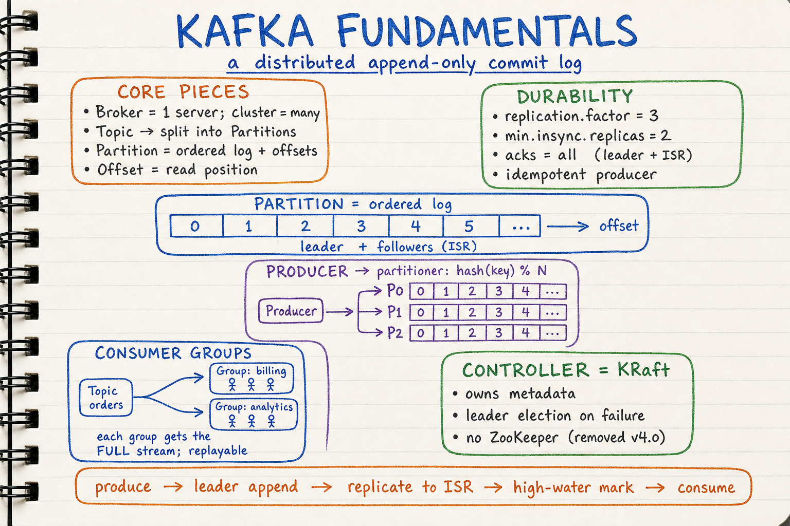
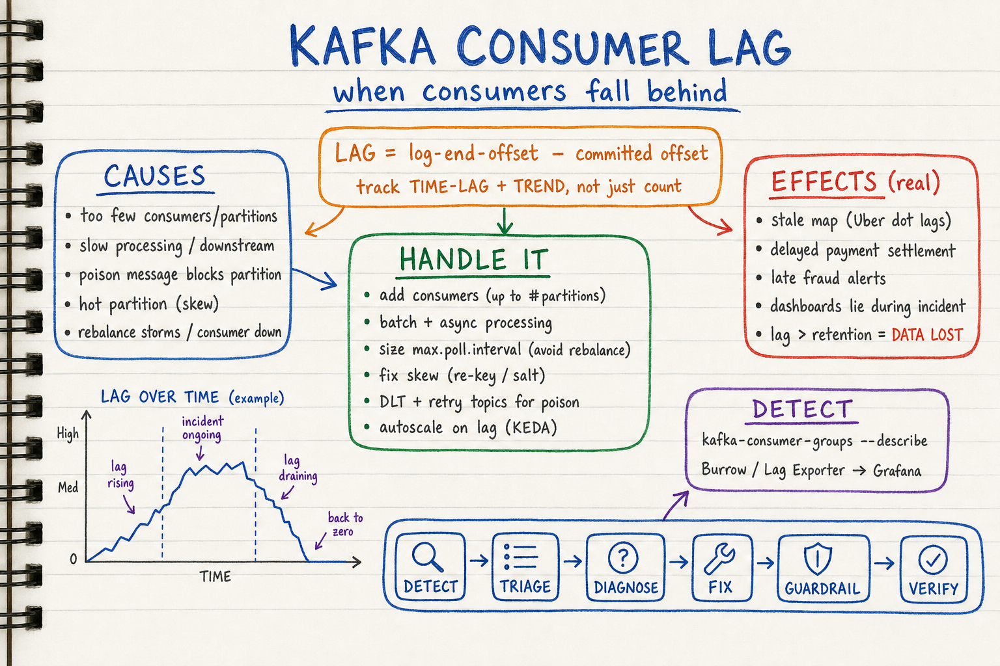
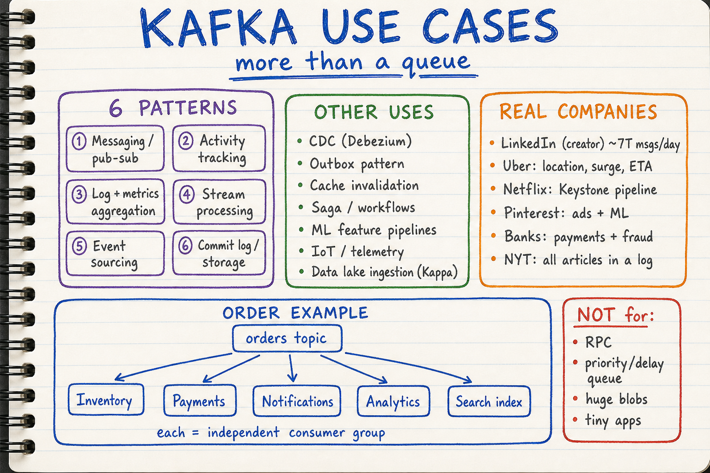
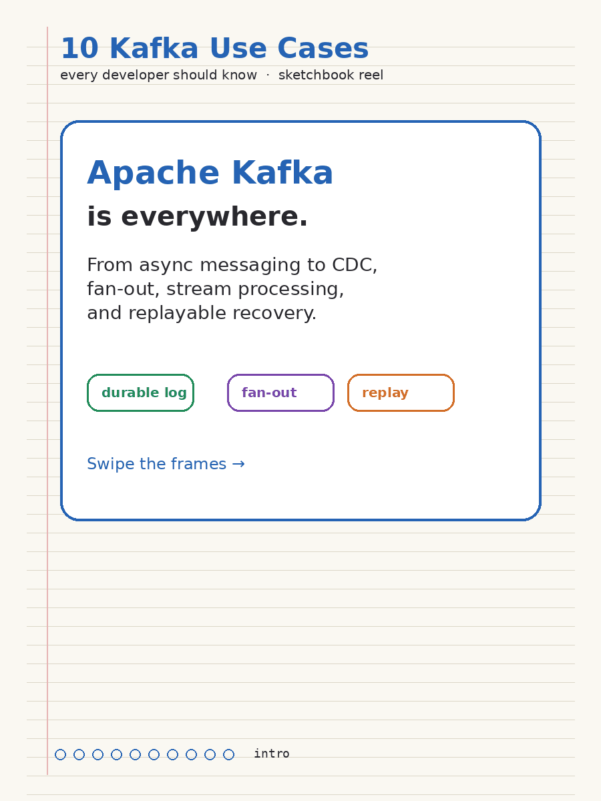
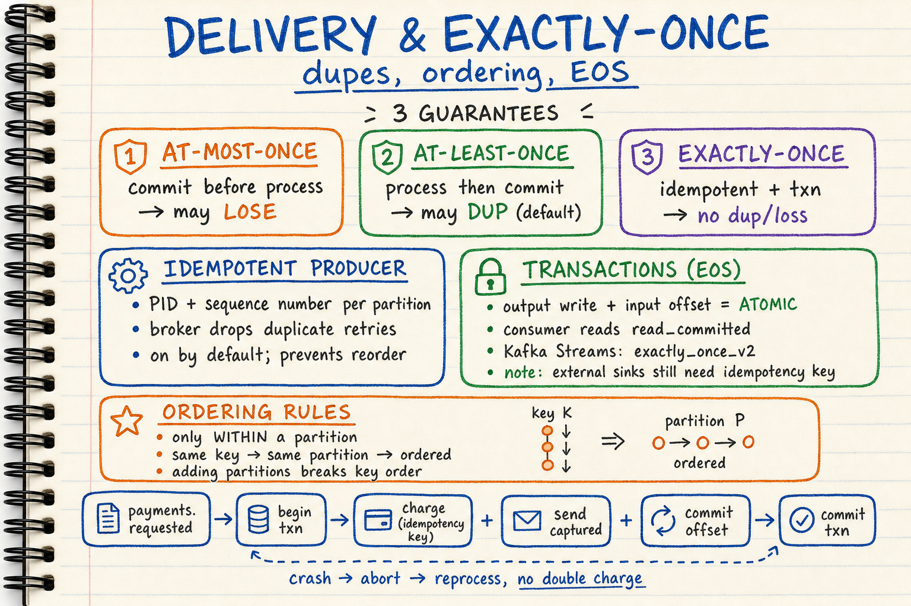
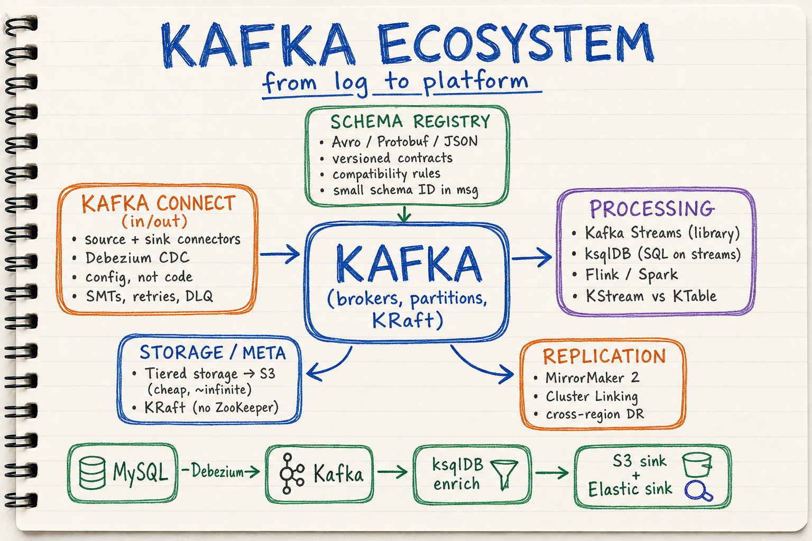
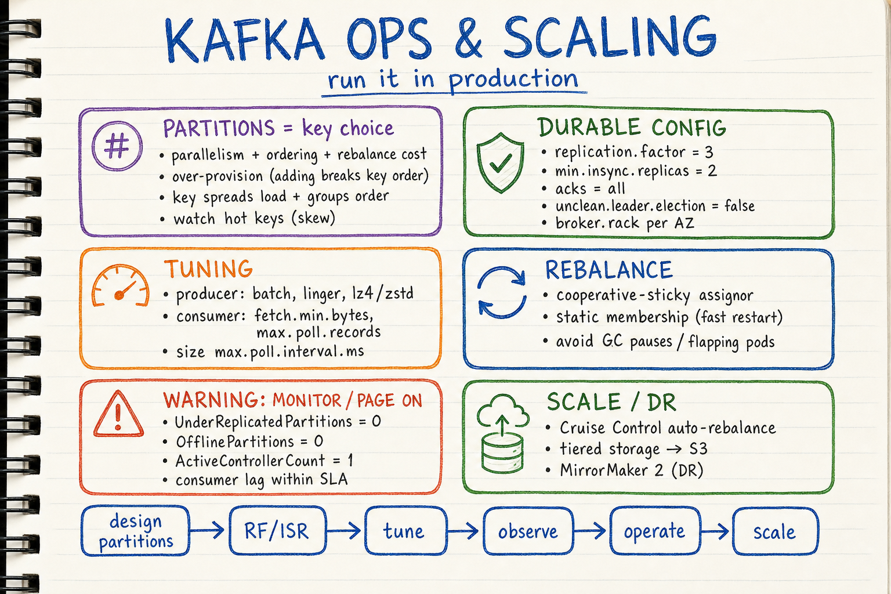

# Kafka Visual Notes

Sketchbook-style visual learning notes for **Apache Kafka** — the distributed, replayable commit log at the heart of modern event-streaming platforms. Sourced from the Apache Kafka docs/KIPs, Confluent engineering, and public engineering blogs (LinkedIn, Uber, Netflix).

Each topic has **two parts**:
- a **summary diagram** (`.png`) — the quick, visual sketchbook overview, and
- a **detailed markdown** (`.md`) — the in-depth reference with source links.

| Topic | Summary diagram | Detailed notes |
| --- | --- | --- |
| Kafka fundamentals & architecture | `kafka-fundamentals-architecture-sketchbook.png` | [`01-kafka-fundamentals-and-architecture.md`](./01-kafka-fundamentals-and-architecture.md) |
| Consumer lag: detection, effects & handling | `kafka-consumer-lag-sketchbook.png` | [`02-consumer-lag-handling.md`](./02-consumer-lag-handling.md) |
| Use cases & real-life examples | `kafka-use-cases-sketchbook.png` + animated reel `kafka-use-cases-animated.gif` | [`03-use-cases-and-real-life-examples.md`](./03-use-cases-and-real-life-examples.md) |
| Delivery semantics, ordering & exactly-once | `kafka-delivery-semantics-sketchbook.png` | [`04-delivery-semantics-ordering-and-exactly-once.md`](./04-delivery-semantics-ordering-and-exactly-once.md) |
| Ecosystem: Streams, Connect, Schema Registry | `kafka-ecosystem-sketchbook.png` | [`05-kafka-ecosystem-streams-connect-schema-registry.md`](./05-kafka-ecosystem-streams-connect-schema-registry.md) |
| Operations, scaling & reliability | `kafka-operations-scaling-sketchbook.png` | [`06-operations-scaling-and-reliability.md`](./06-operations-scaling-and-reliability.md) |

## Diagrams

### 1. Kafka Fundamentals & Architecture

Detailed notes: [`01-kafka-fundamentals-and-architecture.md`](./01-kafka-fundamentals-and-architecture.md)

Covers:
- **The mental model**: a distributed, replayable append-only commit log (not a destructive queue)
- **Core pieces**: broker, topic, **partition** (unit of ordering/parallelism/storage), offset, segment
- **Replication**: leader/follower, **ISR**, high-water mark, `acks`/`min.insync.replicas`
- **Producers**: partitioner (`hash(key) % N`), batching/compression, idempotence
- **Consumer groups**: partition assignment, fan-out to independent groups, offset commits
- **Controller / KRaft** (ZooKeeper removed in 4.0) and the produce→replicate→consume flow

### 2. Consumer Lag: Detection, Effects & Handling

Detailed notes: [`02-consumer-lag-handling.md`](./02-consumer-lag-handling.md)

Covers:
- **What lag is**: `log-end-offset − committed offset`; track **time-lag** and **trend**, not raw count
- **Detection**: `kafka-consumer-groups --describe`, Burrow, Kafka Lag Exporter → Grafana
- **Root causes**: under-provisioning, slow processing, poison messages, skew, rebalance storms
- **Real effects**: stale maps, delayed settlements, late fraud alerts, lying dashboards, **data loss if lag > retention**
- **Handling**: add consumers, batch/async, avoid rebalance-triggering polls, fix skew, **DLT + retry topics**, **KEDA autoscaling**

### 3. Use Cases & Real-Life Examples

**Animated reel** (autoplays on GitHub READMEs / issues / PRs — native GIF support):

Regenerate with: `python3 kafka/scripts/generate_use_cases_gif.py`

Detailed notes: [`03-use-cases-and-real-life-examples.md`](./03-use-cases-and-real-life-examples.md)

Covers:
- **10-use-case reel**: async messaging, pub-sub fan-out, activity tracking, log aggregation, stream processing, metrics & alerting, event sourcing, CDC, data pipelines, replay & recovery
- **6 patterns** (docs framing): messaging, activity tracking, log/metrics aggregation, stream processing, event sourcing, commit-log storage
- **Other uses**: **CDC (Debezium)**, outbox, cache invalidation, sagas, ML feature pipelines, IoT, data-lake ingestion (Kappa)
- **Real companies**: LinkedIn (~7T msgs/day), Uber, Netflix (Keystone), Pinterest, banks, NYT (all content in a log)
- A worked **e-commerce order lifecycle** and honest **anti-patterns** (RPC, priority/delay queues, huge blobs)

### 4. Delivery Semantics, Ordering & Exactly-Once

Detailed notes: [`04-delivery-semantics-ordering-and-exactly-once.md`](./04-delivery-semantics-ordering-and-exactly-once.md)

Covers:
- **Three guarantees**: at-most-once, **at-least-once** (default), exactly-once
- **Idempotent producer** (PID + sequence) — removes retry duplicates and reordering
- **Transactions / EOS**: atomic output-write + offset-commit, `read_committed`, `exactly_once_v2`
- **Ordering rules**: per-partition only, keyed by message key; repartitioning caveat
- A **payment processed exactly once** worked example (Kafka EOS + external idempotency key)

### 5. Ecosystem: Streams, Connect, Schema Registry

Detailed notes: [`05-kafka-ecosystem-streams-connect-schema-registry.md`](./05-kafka-ecosystem-streams-connect-schema-registry.md)

Covers:
- **Kafka Connect**: config-driven source/sink connectors, Debezium CDC, SMTs, DLQ
- **Processing**: Kafka Streams (library), ksqlDB (SQL), Flink/Spark; **KStream vs KTable**
- **Schema Registry**: Avro/Protobuf/JSON contracts + compatibility rules
- **Tiered storage** (KIP-405), **KRaft** (KIP-500), and cross-cluster **MirrorMaker 2 / Cluster Linking**

### 6. Operations, Scaling & Reliability

Detailed notes: [`06-operations-scaling-and-reliability.md`](./06-operations-scaling-and-reliability.md)

Covers:
- **Partition strategy** (parallelism/ordering/rebalance cost) and durable config (`RF=3`, `min.insync.replicas=2`, `acks=all`, no unclean election)
- **Throughput vs latency tuning** and **rebalance** control (cooperative-sticky, static membership)
- **Monitoring vitals**: under-replicated/offline partitions, `ActiveControllerCount==1`, consumer lag
- **Security** (TLS/SASL/ACLs) and **scale/DR** (Cruise Control, tiered storage, MirrorMaker 2)

## Style

All diagrams follow the repository's sketchbook visual style. See:
- `docs/sketchbook-style-guide.md`
- `docs/system-design-note-template.md`
