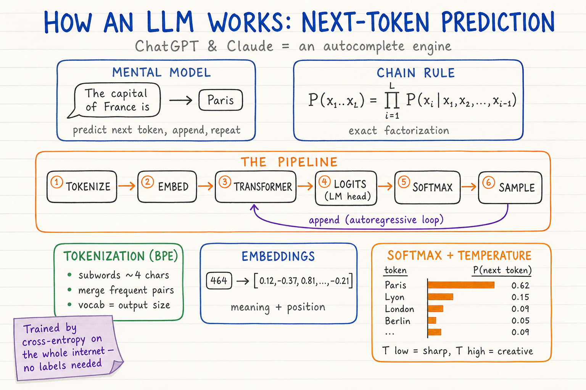
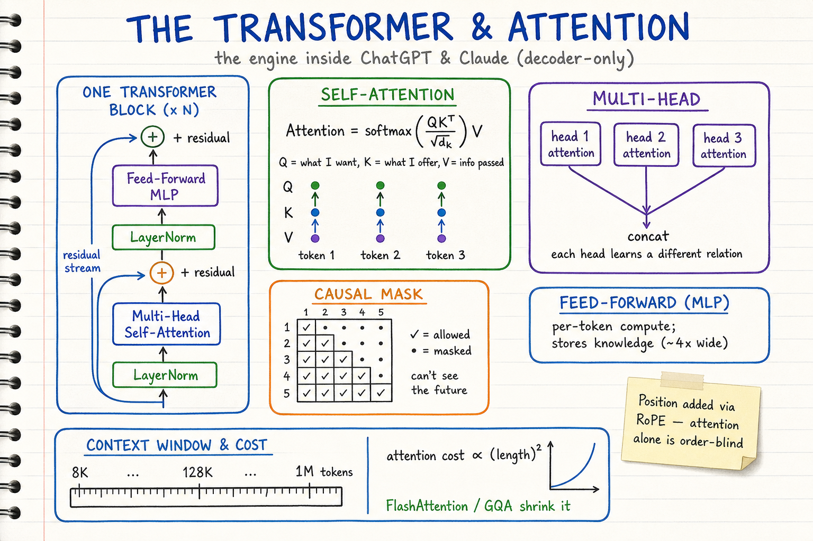
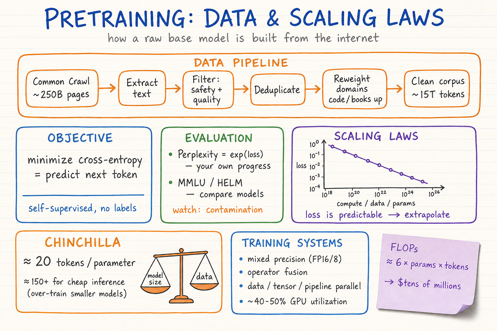
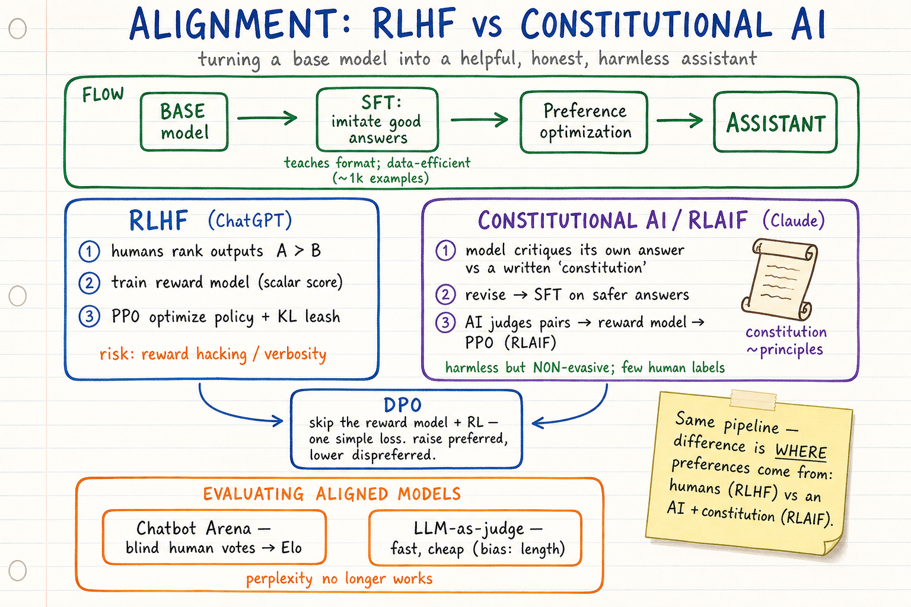
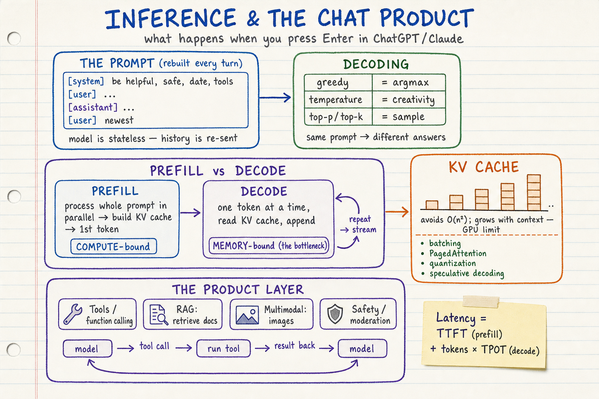

# How ChatGPT & Claude Work — LLM Visual Notes

Sketchbook-style visual learning notes for **how large language models (LLMs) like ChatGPT and Claude actually work** — end to end, from a token to a streamed assistant reply.

Primary source: Stanford **CS229 — "Building Large Language Models (LLMs)"** (Yann Dubois), <https://youtu.be/9vM4p9NN0Ts>, expanded with foundational papers (Transformer, GPT-3, Chinchilla, InstructGPT, Constitutional AI) and vendor/engineering docs from OpenAI and Anthropic.

Each topic has **two parts**:
- a **summary diagram** (`.png`) — the quick, visual sketchbook overview, and
- a **detailed markdown** (`.md`) — the in-depth reference with source links.

| Topic | Summary diagram | Detailed notes |
| --- | --- | --- |
| What an LLM is & next-token prediction | `llm-next-token-prediction-sketchbook.png` | [`01-what-is-an-llm-and-next-token-prediction.md`](./01-what-is-an-llm-and-next-token-prediction.md) |
| Transformer architecture & attention | `llm-transformer-attention-sketchbook.png` | [`02-transformer-architecture-and-attention.md`](./02-transformer-architecture-and-attention.md) |
| Pretraining: data & scaling laws | `llm-pretraining-data-scaling-sketchbook.png` | [`03-pretraining-data-and-scaling-laws.md`](./03-pretraining-data-and-scaling-laws.md) |
| Post-training: RLHF & Constitutional AI | `llm-alignment-rlhf-constitutional-sketchbook.png` | [`04-post-training-alignment-rlhf-and-constitutional-ai.md`](./04-post-training-alignment-rlhf-and-constitutional-ai.md) |
| Inference, serving & the chat product | `llm-inference-serving-chat-product-sketchbook.png` | [`05-inference-serving-and-the-chat-product.md`](./05-inference-serving-and-the-chat-product.md) |

## The big picture

```
                       ┌─────────────── HOW A MODEL IS BUILT ───────────────┐
  ①  next-token   ▶ ②  Transformer ▶ ③  Pretraining ▶ ④  Post-training ▶  ⑤  Inference /
     prediction        + attention      (base model)     (alignment)          the product
  (tokenize→embed→   (Q/K/V, heads,   (data pipeline,   SFT + RLHF (ChatGPT)  (KV cache, decode,
   logits→softmax)    FFN, context)    scaling laws)     / Constitutional AI   tools, RAG, safety)
                                                          (Claude))
```

ChatGPT and Claude are the **same core engine** — a decoder-only Transformer trained to predict the next token — differentiated mainly by **how they are aligned** (RLHF vs Constitutional AI/RLAIF) and the **product/serving** layer wrapped around them.

## Diagrams

### 1. What an LLM Is & Next-Token Prediction



Detailed notes: [`01-what-is-an-llm-and-next-token-prediction.md`](./01-what-is-an-llm-and-next-token-prediction.md)

Covers:
- **The mental model**: an LLM is an autocomplete engine — a probability distribution over token sequences
- **Chain rule** factorization → predict the next token; **cross-entropy** self-supervised training
- **Pipeline**: tokenize → embed → transformer → logits → softmax → sample → repeat
- **Tokenization** (subwords, **BPE**), **embeddings**, and softmax/temperature intro

### 2. Transformer Architecture & Attention



Detailed notes: [`02-transformer-architecture-and-attention.md`](./02-transformer-architecture-and-attention.md)

Covers:
- **Decoder-only** stack: attention + feed-forward + residuals + layer norm
- **Self-attention** as content-based lookup: `softmax(QKᵀ/√d)·V`; **causal mask**; **multi-head**
- **FFN/MLP** (where knowledge lives), **positional encodings** (RoPE), **GQA/MQA**
- **Context window** and the **O(L²)** cost; FlashAttention & mitigations

### 3. Pretraining: Data & Scaling Laws



Detailed notes: [`03-pretraining-data-and-scaling-laws.md`](./03-pretraining-data-and-scaling-laws.md)

Covers:
- **Data pipeline**: crawl → extract → filter → dedup → domain reweight → high-quality anneal
- **Evaluation**: perplexity (and its limits), **MMLU/HELM**, contamination
- **Scaling laws** and **Chinchilla** (~20 tokens/param; ~150+ for inference economics)
- **Training systems**: mixed precision, operator fusion, data/tensor/pipeline parallelism, cost

### 4. Post-Training: RLHF & Constitutional AI



Detailed notes: [`04-post-training-alignment-rlhf-and-constitutional-ai.md`](./04-post-training-alignment-rlhf-and-constitutional-ai.md)

Covers:
- **SFT** (teach the assistant format; data-efficient) and its limits (behavior cloning)
- **RLHF** (ChatGPT): human preferences → reward model → **PPO** + KL leash; reward hacking
- **DPO** as a simpler alternative
- **Constitutional AI / RLAIF** (Claude): self-critique/revise + AI-judged preferences from a written **constitution**
- Evaluating aligned models: **Chatbot Arena**, **LLM-as-judge**

### 5. Inference, Serving & the Chat Product



Detailed notes: [`05-inference-serving-and-the-chat-product.md`](./05-inference-serving-and-the-chat-product.md)

Covers:
- Stateless model + re-sent **system prompt + history**; chat templates
- **Decoding**: greedy/temperature/top-k/top-p; the autoregressive streaming loop
- **Prefill vs decode**, the **KV cache**, why decode is **memory-bound**; serving optimizations (continuous batching, PagedAttention, quantization, speculative decoding)
- **Product layer**: tools/function-calling, **RAG**, multimodality, reasoning modes, **safety/moderation**

## Style

All diagrams follow the repository's sketchbook visual style. See:
- `docs/sketchbook-style-guide.md`
- `docs/system-design-note-template.md`
