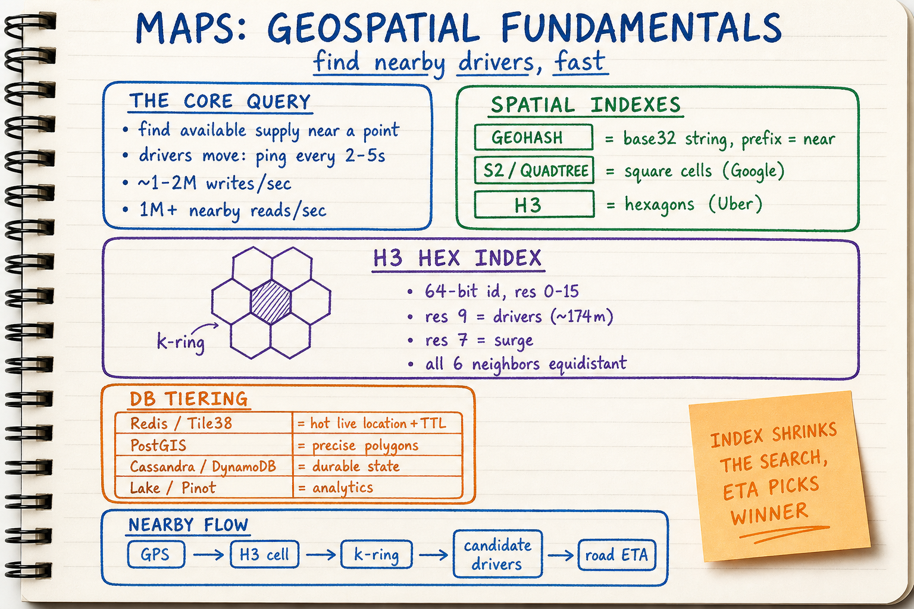
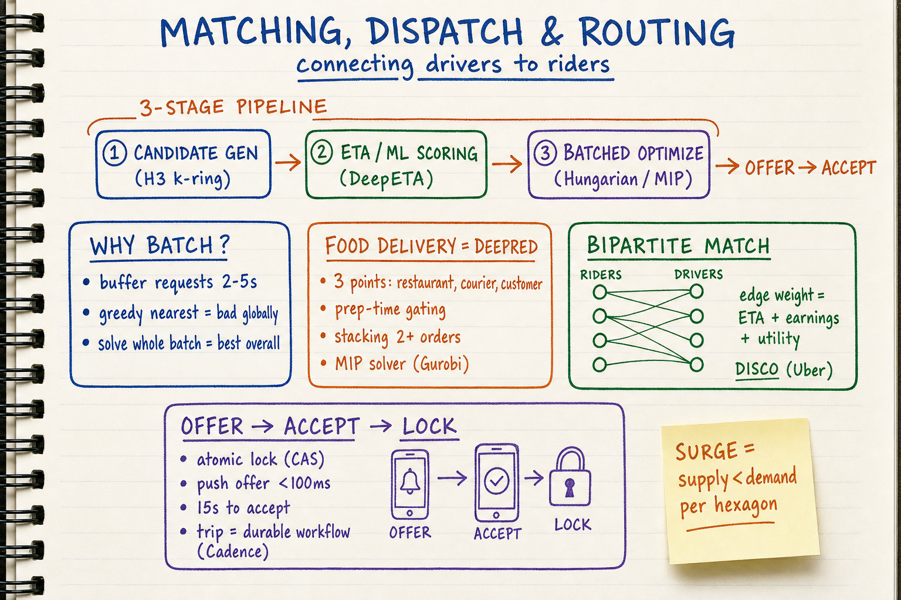
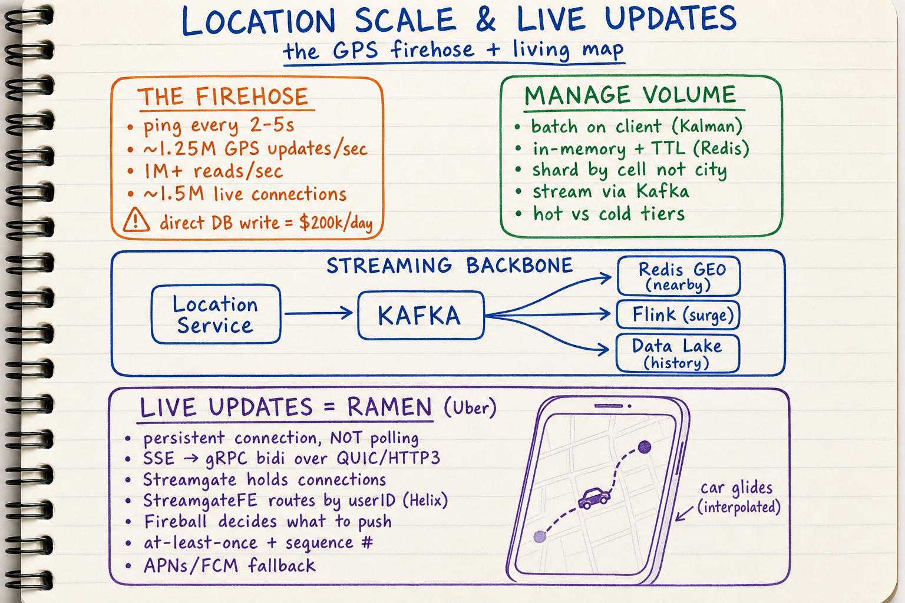
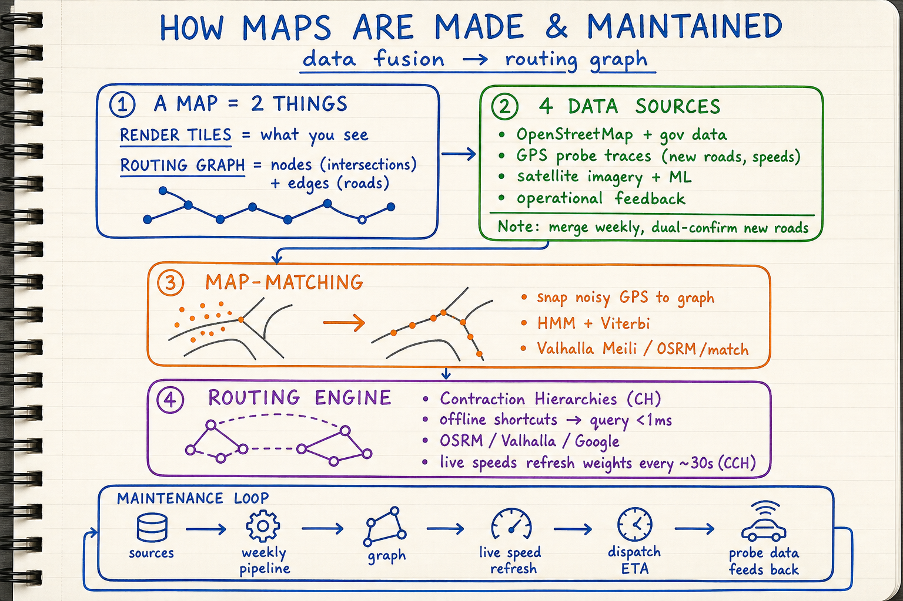
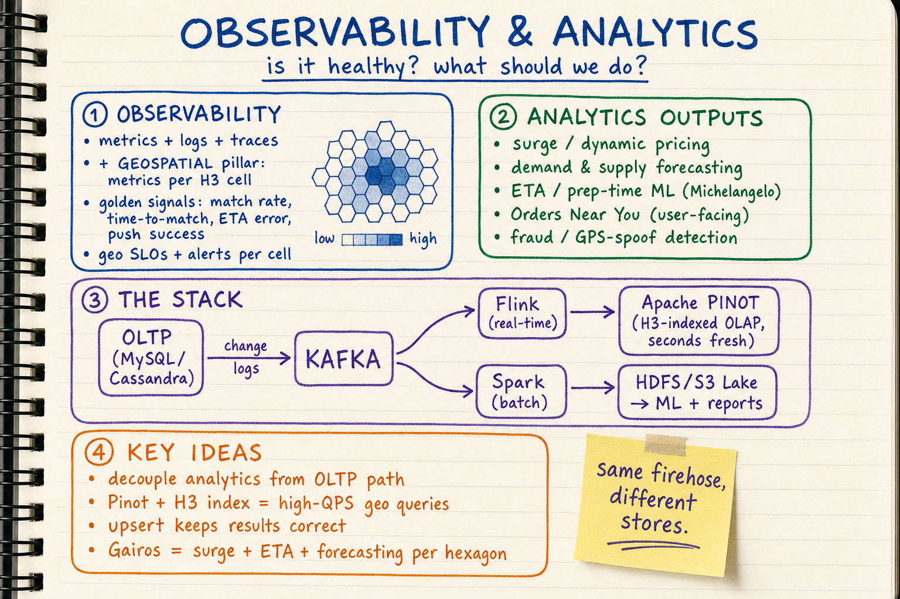

# Maps & Location Systems — Visual Notes

Sketchbook-style visual learning notes for the **maps, geospatial & real-time location systems** that power ride-hailing (Uber, Ola, Rapido, Namma Yatri) and food delivery (Swiggy, Zomato, DoorDash) — how they connect **drivers ↔ riders** and **delivery agents ↔ restaurant ↔ customer**. Sourced from engineering material by Uber, Lyft, DoorDash, OpenStreetMap/OSRM/Valhalla, Apache Pinot/Flink/Kafka, and Tile38/PostGIS.

Each topic has **two parts**:
- a **summary diagram** (`.png`) — the quick, visual sketchbook overview, and
- a **detailed markdown** (`.md`) — the in-depth reference with source links.

| Topic | Summary diagram | Detailed notes |
| --- | --- | --- |
| Geospatial fundamentals & spatial databases | `maps-geospatial-fundamentals-spatial-db-sketchbook.png` | [`01-geospatial-fundamentals-and-spatial-databases.md`](./01-geospatial-fundamentals-and-spatial-databases.md) |
| Matching, dispatch & routing | `maps-matching-dispatch-routing-sketchbook.png` | [`02-matching-dispatch-and-routing.md`](./02-matching-dispatch-and-routing.md) |
| Location ingestion at scale & live updates | `maps-location-ingestion-live-updates-sketchbook.png` | [`03-location-ingestion-scale-and-live-updates.md`](./03-location-ingestion-scale-and-live-updates.md) |
| Map creation & maintenance (routing graph) | `maps-creation-maintenance-sketchbook.png` | [`04-map-creation-and-maintenance.md`](./04-map-creation-and-maintenance.md) |
| Observability & geospatial analytics | `maps-observability-analytics-sketchbook.png` | [`05-observability-and-analytics.md`](./05-observability-and-analytics.md) |

## How these notes map to the questions

- **How does this work?** → notes 01 (spatial index) + 02 (dispatch) end-to-end.
- **What database (SQL / NoSQL / spatial)?** → note 01 (Redis/Tile38 hot, PostGIS precise, Cassandra/DynamoDB durable, Pinot/lake analytics).
- **What is the transaction rate?** → note 03 (~1–2M location writes/sec, 1M+ reads/sec).
- **How to manage high volume of data?** → note 03 (batch → in-memory + TTL → Kafka → tiering).
- **How are live updates relayed?** → note 03 (RAMEN: SSE → gRPC bidi push).
- **How is observability added?** → note 05 (metrics/logs/traces + per-H3-cell geo SLOs).
- **How does the company add analytics?** → note 05 (Kafka → Flink/Spark → Pinot + H3 index).
- **How are the maps created & maintained?** → note 04 (OSM + probe + satellite fusion, map-matching, Contraction Hierarchies).

## Diagrams

### 1. Geospatial Fundamentals & Spatial Databases

Detailed notes: [`01-geospatial-fundamentals-and-spatial-databases.md`](./01-geospatial-fundamentals-and-spatial-databases.md)

Covers:
- The one core query: **find nearby available supply** (~1M+/sec)
- **Spatial indexes**: geohash, S2/quadtree, and **H3** (Uber's hexagonal 64-bit index)
- **H3 mechanics**: resolutions (res-9 drivers, res-7 surge), k-ring, equidistant neighbours
- **R-tree / GiST** behind spatial SQL
- **DB tiering**: Redis/Tile38 (hot) vs PostGIS (precise) vs Cassandra/DynamoDB (durable) vs lake/Pinot (analytics)

### 2. Matching, Dispatch & Routing

Detailed notes: [`02-matching-dispatch-and-routing.md`](./02-matching-dispatch-and-routing.md)

Covers:
- The **3-stage pipeline**: candidate generation → ETA/ML scoring → batched optimization
- **Batched bipartite matching** (Uber **DISCO**, Hungarian algorithm) vs greedy
- **DeepETA** (physics + ML, p95 ≈ 4 ms) and **Michelangelo**
- Food delivery's **DeepRed** (prep-time, stacking, strategic delay, **MIP/Gurobi**)
- **Offer → accept → atomic lock**, push < 100 ms, durable trip workflow (**Cadence**), surge

### 3. Location Ingestion at Scale & Live Updates

Detailed notes: [`03-location-ingestion-scale-and-live-updates.md`](./03-location-ingestion-scale-and-live-updates.md)

Covers:
- The **transaction rate**: ~2–5 s pings × millions of drivers ≈ **~1–2M writes/sec**
- Managing volume: **batch → in-memory + TTL → Kafka fan-out → hot/cold tiering** (and why direct DB writes cost >$200k/day)
- Sharding by **spatial cell** (S2/H3) to avoid hot shards
- **Live updates via RAMEN**: SSE → **gRPC bidi over QUIC/HTTP3**, Streamgate/StreamgateFE/Helix, Fireball, at-least-once + sequence numbers, APNs/FCM fallback

### 4. Map Creation & Maintenance (the Routing Graph)

Detailed notes: [`04-map-creation-and-maintenance.md`](./04-map-creation-and-maintenance.md)

Covers:
- A map = **render tiles** + a **routing graph** (nodes/edges)
- **Data fusion**: OpenStreetMap + gov data + GPS probe traces + satellite ML (weekly pipeline, dual-confirm new roads)
- **Map-matching**: snapping noisy GPS via **HMM + Viterbi** (Valhalla Meili, OSRM `/match`)
- **Contraction Hierarchies** for sub-millisecond routing + **CCH** live-speed refresh (~30 s)

### 5. Observability & Geospatial Analytics

Detailed notes: [`05-observability-and-analytics.md`](./05-observability-and-analytics.md)

Covers:
- **Observability**: metrics + logs + traces **plus a geospatial pillar** (metrics per H3 cell, geo SLOs, dispatch golden signals)
- **Analytics stack**: OLTP → Kafka → **Flink/Spark** → **Apache Pinot** (H3-indexed OLAP, seconds fresh) + data lake
- Outputs: **surge**, demand/supply forecasting, ETA/prep ML (**Michelangelo**), "Orders near you," fraud detection
- **Gairos** real-time platform; decoupling analytics from the serving path

## Style

All diagrams follow the repository's sketchbook visual style. See:
- `docs/sketchbook-style-guide.md`
- `docs/system-design-note-template.md`
