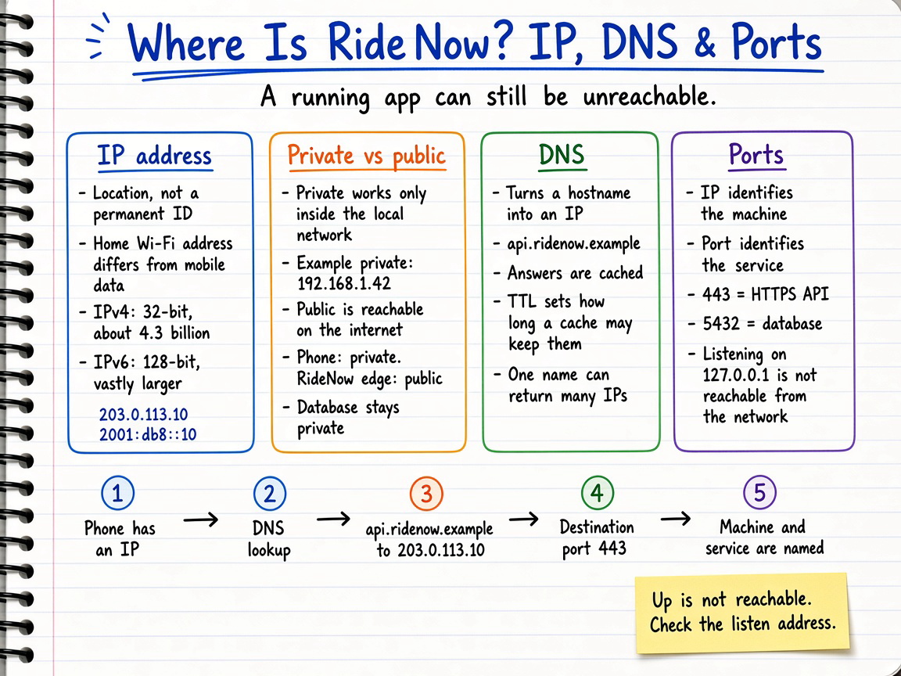
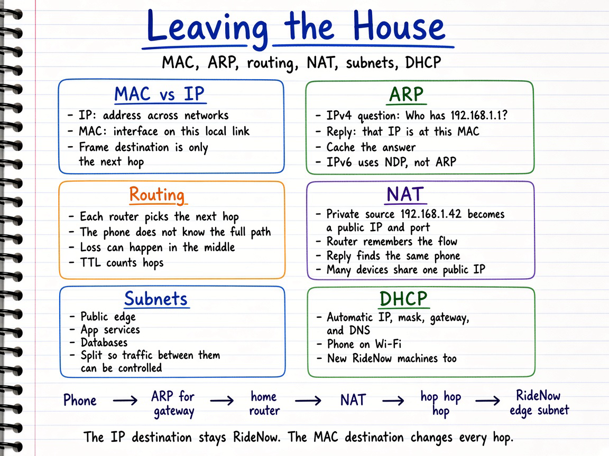
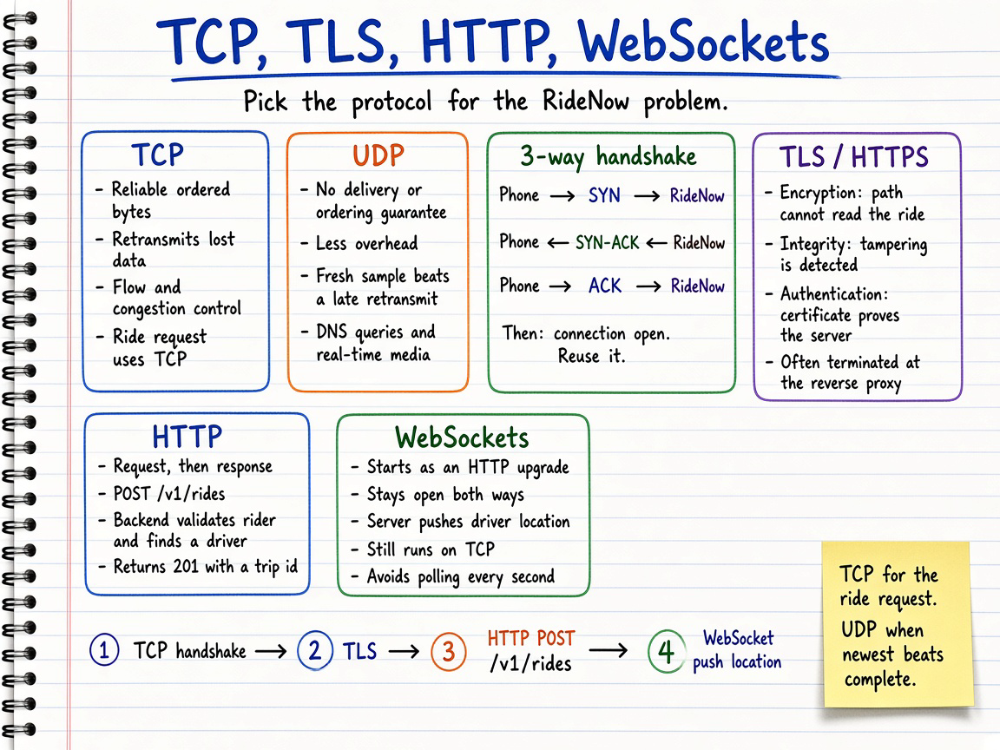
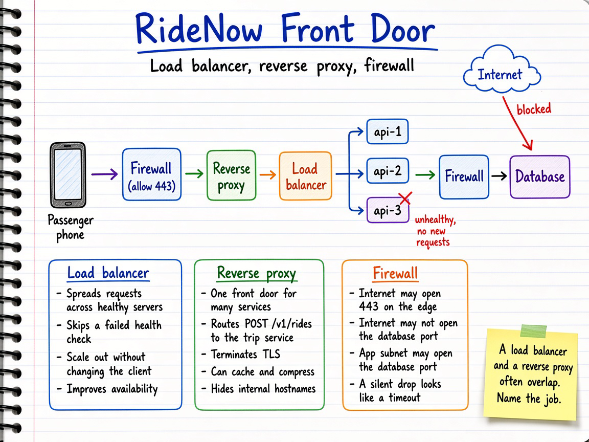
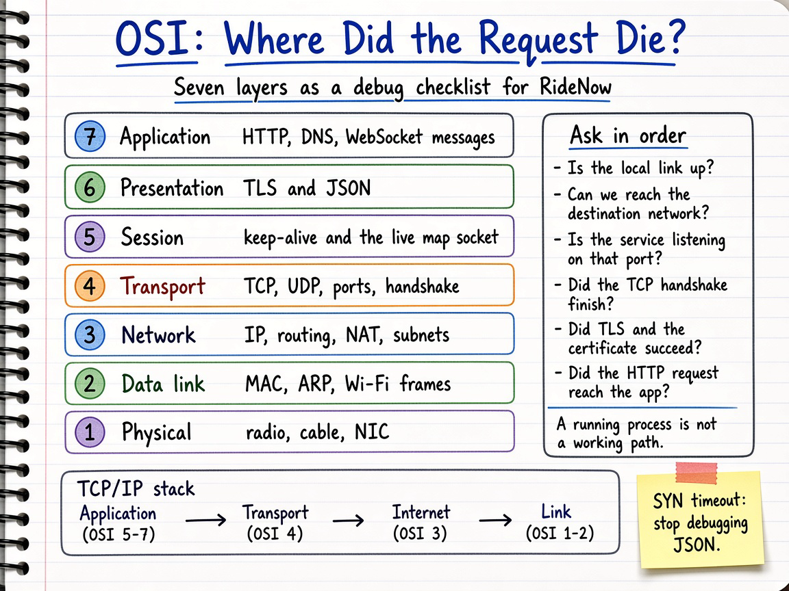
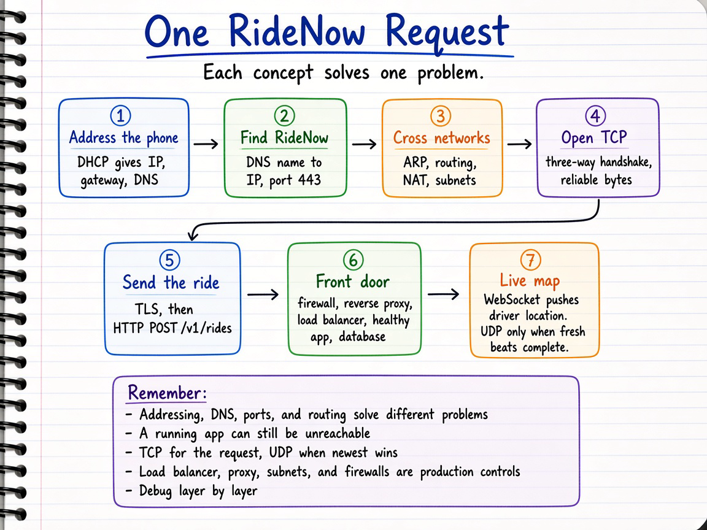

# OSI & Networking Visual Notes

Sketchbook-style notes for networking fundamentals, taught as **one RideNow request**.

RideNow is a fictional ride-sharing app. A passenger taps **Request Ride**, a driver accepts, and the passenger watches the car move. Each note is one stretch of that journey, paired with a summary diagram. The order follows [Cloud X Berry's walkthrough](https://www.youtube.com/watch?v=TR0RU2pmMeA): concepts show up when the request needs them, and the OSI model shows up last as a way to find where a failure sits.

Each topic has **two parts**:

- a **summary diagram** (`.png`) — the quick, visual sketchbook overview, and
- a **detailed markdown** (`.md`) — the in-depth reference with source links.

| Topic | Summary diagram | Detailed notes |
| --- | --- | --- |
| Addressing, DNS & ports | `addressing-dns-ports-sketchbook.png` | [`01-addressing-dns-and-ports.md`](./01-addressing-dns-and-ports.md) |
| Local delivery, routing, NAT & subnets | `local-routing-nat-subnets-sketchbook.png` | [`02-local-delivery-routing-nat.md`](./02-local-delivery-routing-nat.md) |
| Transport & application protocols | `transport-application-protocols-sketchbook.png` | [`03-transport-and-application-protocols.md`](./03-transport-and-application-protocols.md) |
| Infrastructure & network security | `infrastructure-security-sketchbook.png` | [`04-infrastructure-and-network-security.md`](./04-infrastructure-and-network-security.md) |
| OSI model as a troubleshooting map | `osi-troubleshooting-sketchbook.png` | [`05-osi-model-troubleshooting.md`](./05-osi-model-troubleshooting.md) |
| One RideNow request, start to finish | `ridenow-request-journey-sketchbook.png` | [`06-ridenow-request-journey.md`](./06-ridenow-request-journey.md) |

## Diagrams

### 1. Addressing, DNS & Ports

Detailed notes: [`01-addressing-dns-and-ports.md`](./01-addressing-dns-and-ports.md)

Video chapters: IP address (1:30), DNS (4:50), ports (5:48).

Covers:

- **IP as a location**, not a permanent device identity; the phone's Wi-Fi address and its cellular address differ
- **IPv4 vs IPv6**: 32-bit and 128-bit
- **Private vs public**: the phone and the database stay private; RideNow's front door is public
- **DNS**: name to address, cache, TTL, one name with many addresses
- **Ports**: the service on that machine; listening on localhost is not "reachable"

### 2. Local Delivery, Routing, NAT & Subnets

Detailed notes: [`02-local-delivery-routing-nat.md`](./02-local-delivery-routing-nat.md)

Video chapters: MAC (6:48), ARP (7:39), routing (8:30), NAT (9:17), subnetting (10:18), DHCP (11:16).

Covers:

- **MAC vs IP**, and **ARP** ("who has this IPv4 address?") on the local link
- **Hop-by-hop routing**: the phone never knows the whole path
- **NAT**: many private devices share a public connection; the router remembers the flow
- **Subnets**: public edge, application tier, database tier
- **DHCP**: IP, gateway, and DNS without typing them

### 3. Transport & Application Protocols

Detailed notes: [`03-transport-and-application-protocols.md`](./03-transport-and-application-protocols.md)

Video chapters: TCP (12:17), three-way handshake (13:07), HTTPS/TLS (13:51), HTTP (15:02), WebSockets (18:50), UDP (20:18).

Covers:

- **TCP** for a ride request that must arrive complete and in order
- **Three-way handshake**, and why RideNow reuses the connection
- **TLS**: encryption, integrity, certificates; termination often at the proxy
- **HTTP** request and response (`POST /v1/rides`)
- **WebSockets** so the server can push driver location
- **UDP** when a newer sample beats a retransmission

### 4. Infrastructure & Network Security

Detailed notes: [`04-infrastructure-and-network-security.md`](./04-infrastructure-and-network-security.md)

Video chapters: load balancer (15:41), reverse proxy (16:33), firewall (17:40).

Covers:

- **Load balancer**: spread traffic across healthy servers; drop unhealthy ones
- **Reverse proxy**: route, terminate TLS, cache, compress, hide internal services
- Where those two jobs **overlap** in real products
- **Firewalls** and security groups: internet may reach port 443; it may not reach the database
- A timeout with a healthy process is often a **dropped** packet

### 5. OSI Model as a Troubleshooting Map

Detailed notes: [`05-osi-model-troubleshooting.md`](./05-osi-model-troubleshooting.md)

Video chapter: OSI model (21:29).

Covers:

- Seven layers, each tied to a RideNow mechanism (not a list to recite)
- How OSI lines up with the **TCP/IP** stack
- The questions to ask in order: link, route, port, TCP handshake, TLS, HTTP
- Encapsulation and the commands that answer each layer

### 6. One RideNow Request, Start to Finish

Detailed notes: [`06-ridenow-request-journey.md`](./06-ridenow-request-journey.md)

Video chapter: recap (22:50).

Covers:

- The whole tap, in seven stages: address, find, move, connect, secure and send, front door, live updates
- Which failure symptom belongs to which stage
- The five takeaways: different problems, connectivity vs health, protocol choice, infrastructure controls, OSI as a checklist

## Style

Diagrams follow the repository's sketchbook visual style. See:

- `docs/sketchbook-style-guide.md`
- `docs/system-design-note-template.md`
