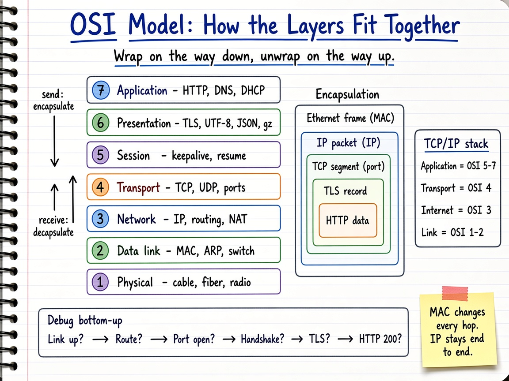
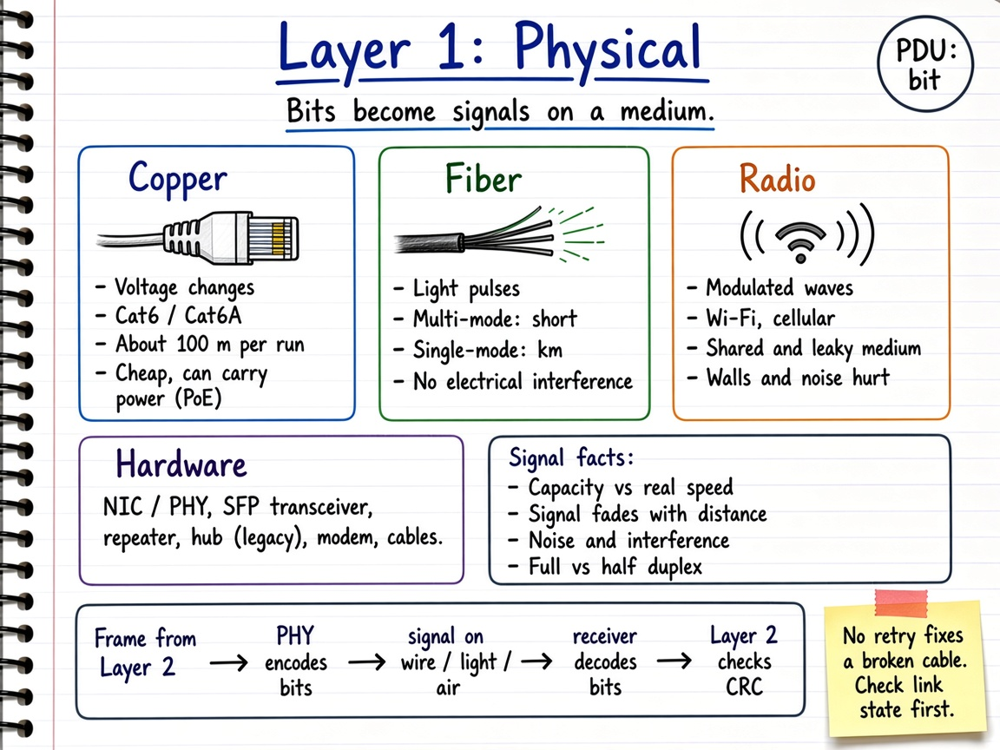
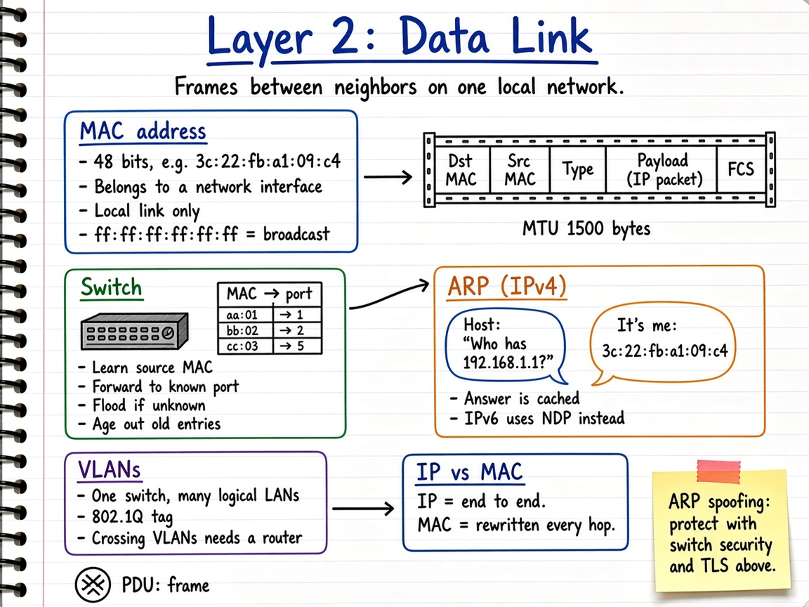
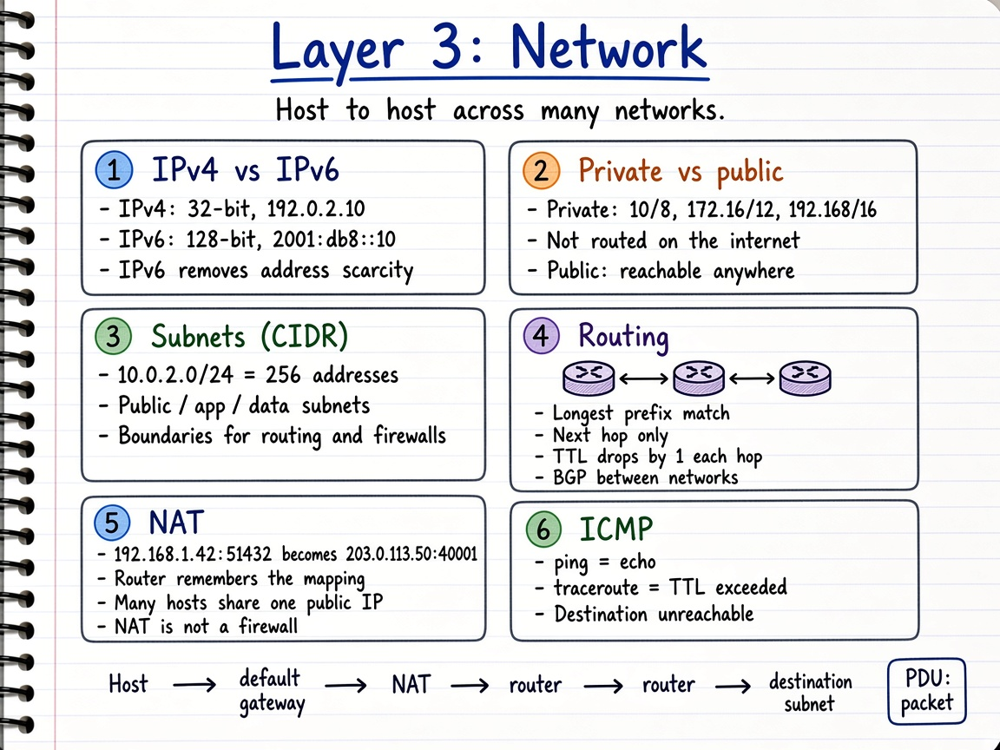
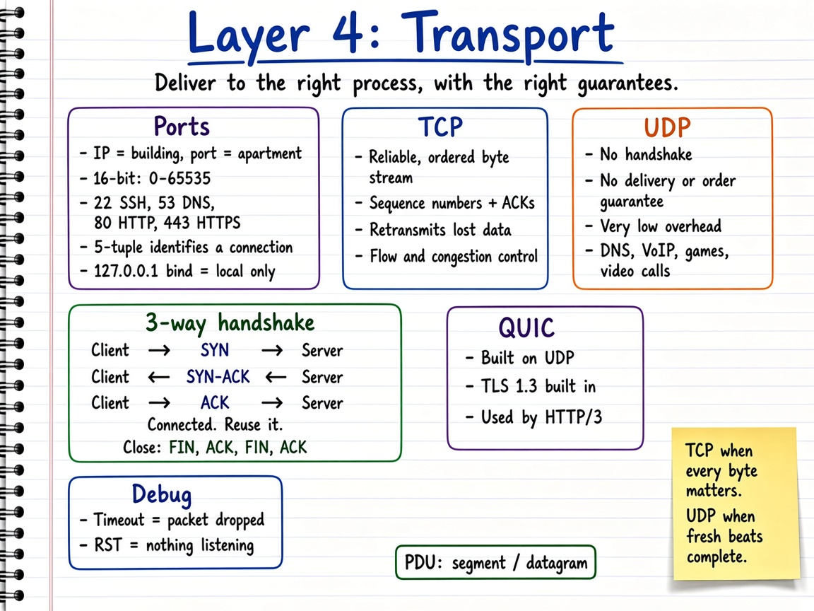
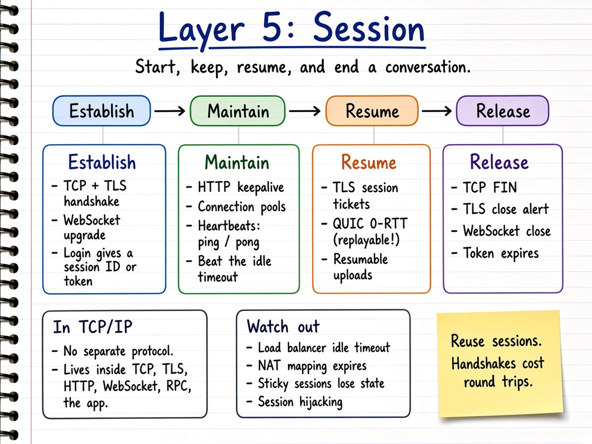
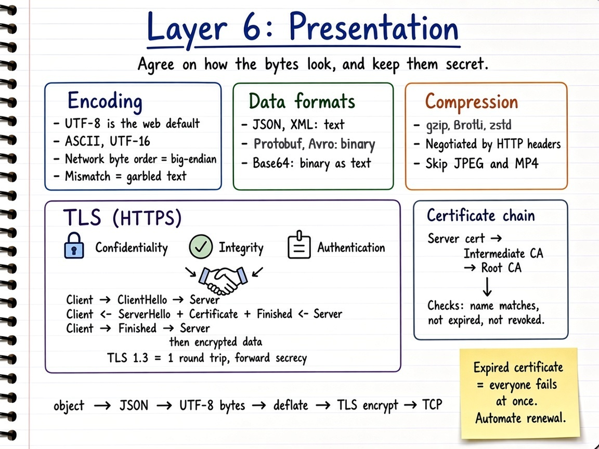
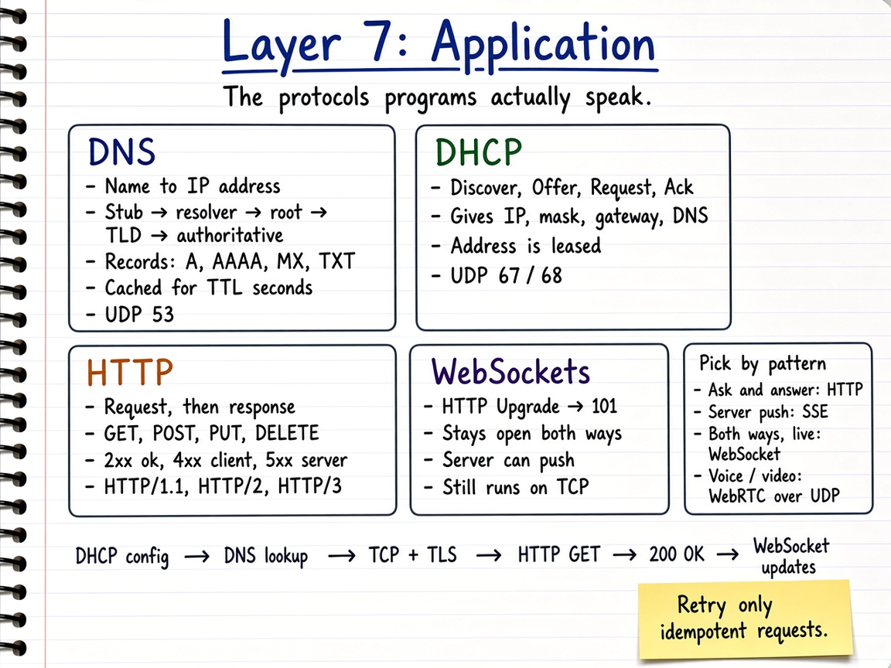
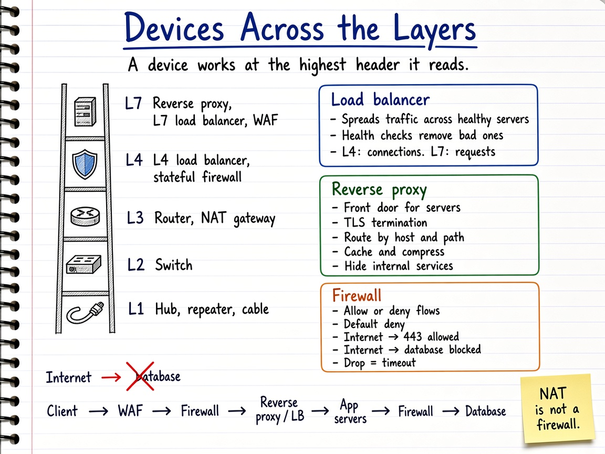

# OSI & Networking Visual Notes

Sketchbook-style notes for networking fundamentals, organized by **OSI layer**.

Start with the **summary** to see how the seven layers fit together, then open any layer's diagram for a one-page refresher, or its markdown for the deep dive.

Each topic has **two parts**:

- a **summary diagram** (`.png`) — the quick, visual sketchbook overview, and
- a **detailed markdown** (`.md`) — the in-depth reference with source links.

| # | Topic | Summary diagram | Detailed notes |
| --- | --- | --- | --- |
| 0 | **Summary: how the layers fit together** | `osi-overview-sketchbook.png` | [`00-osi-model-overview.md`](./00-osi-model-overview.md) |
| 1 | Physical | `physical-layer-sketchbook.png` | [`01-physical-layer.md`](./01-physical-layer.md) |
| 2 | Data link | `data-link-layer-sketchbook.png` | [`02-data-link-layer.md`](./02-data-link-layer.md) |
| 3 | Network | `network-layer-sketchbook.png` | [`03-network-layer.md`](./03-network-layer.md) |
| 4 | Transport | `transport-layer-sketchbook.png` | [`04-transport-layer.md`](./04-transport-layer.md) |
| 5 | Session | `session-layer-sketchbook.png` | [`05-session-layer.md`](./05-session-layer.md) |
| 6 | Presentation | `presentation-layer-sketchbook.png` | [`06-presentation-layer.md`](./06-presentation-layer.md) |
| 7 | Application | `application-layer-sketchbook.png` | [`07-application-layer.md`](./07-application-layer.md) |
| 8 | Devices & security across layers | `devices-across-layers-sketchbook.png` | [`08-devices-and-security-across-layers.md`](./08-devices-and-security-across-layers.md) |

## Where each concept lives

| Concept | Layer | Notes |
| --- | --- | --- |
| Cables, fiber, radio, NIC | 1 | [Physical](./01-physical-layer.md) |
| MAC address, ARP, switches, VLANs | 2 | [Data link](./02-data-link-layer.md) |
| IPv4 / IPv6, private vs public IP, subnetting, routing, NAT, ICMP | 3 | [Network](./03-network-layer.md) |
| Ports, TCP, three-way handshake, UDP, QUIC | 4 | [Transport](./04-transport-layer.md) |
| Keep-alive, connection reuse, session resumption, heartbeats | 5 | [Session](./05-session-layer.md) |
| Encoding, serialization, compression, HTTPS / TLS, certificates | 6 | [Presentation](./06-presentation-layer.md) |
| DNS, DHCP, HTTP, WebSockets | 7 | [Application](./07-application-layer.md) |
| Load balancer, reverse proxy, firewall, NAT gateway, WAF | 2–7 | [Devices & security](./08-devices-and-security-across-layers.md) |

## Diagrams

### 0. Summary — How the Layers Fit Together

Detailed notes: [`00-osi-model-overview.md`](./00-osi-model-overview.md)

- All seven layers with their job, PDU, and addressing
- OSI vs the TCP/IP stack
- Encapsulation: `[ Ethernet [ IP [ TCP [ TLS [ HTTP ] ] ] ] ]`
- One browser request traced through every layer
- Troubleshooting bottom-up: link → route → port → handshake → TLS → HTTP

### 1. Physical Layer

Detailed notes: [`01-physical-layer.md`](./01-physical-layer.md)

- Copper, fiber, and radio trade-offs
- NIC/PHY, transceivers, repeaters, hubs, modems
- Bandwidth vs throughput, attenuation, interference, duplex

### 2. Data Link Layer

Detailed notes: [`02-data-link-layer.md`](./02-data-link-layer.md)

- MAC addresses and the Ethernet frame
- How switches learn, forward, and flood
- ARP (IPv4) and NDP (IPv6); VLANs
- Why MAC changes every hop while IP does not

### 3. Network Layer

Detailed notes: [`03-network-layer.md`](./03-network-layer.md)

- IPv4 vs IPv6; private vs public addresses
- Subnetting and CIDR
- Routing: longest prefix match, TTL, BGP
- NAT / NAPT and ICMP

### 4. Transport Layer

Detailed notes: [`04-transport-layer.md`](./04-transport-layer.md)

- Ports, sockets, and the 5-tuple
- TCP reliability and the three-way handshake
- UDP and when to choose it; QUIC
- Timeout vs RST when debugging

### 5. Session Layer

Detailed notes: [`05-session-layer.md`](./05-session-layer.md)

- Establish, maintain, resume, release
- Keep-alive, connection pools, heartbeats, TLS resumption
- Idle timeouts and session security

### 6. Presentation Layer

Detailed notes: [`06-presentation-layer.md`](./06-presentation-layer.md)

- Character encoding, serialization formats, compression
- HTTPS / TLS: confidentiality, integrity, authentication
- TLS 1.3 handshake and the certificate chain

### 7. Application Layer

Detailed notes: [`07-application-layer.md`](./07-application-layer.md)

- DNS resolution, records, caching, and TTL
- DHCP (DORA)
- HTTP methods, status codes, and versions
- WebSockets, and picking a real-time pattern

### 8. Devices & Security Across Layers

Detailed notes: [`08-devices-and-security-across-layers.md`](./08-devices-and-security-across-layers.md)

- Which layer hubs, switches, routers, firewalls, and proxies work at
- L4 vs L7 load balancers; reverse proxies
- Firewalls, security groups, and default deny
- Mapping error symptoms (timeout, 502, 503, 504) to devices

## Style

Diagrams follow the repository's sketchbook visual style. See:

- `docs/sketchbook-style-guide.md`
- `docs/system-design-note-template.md`
