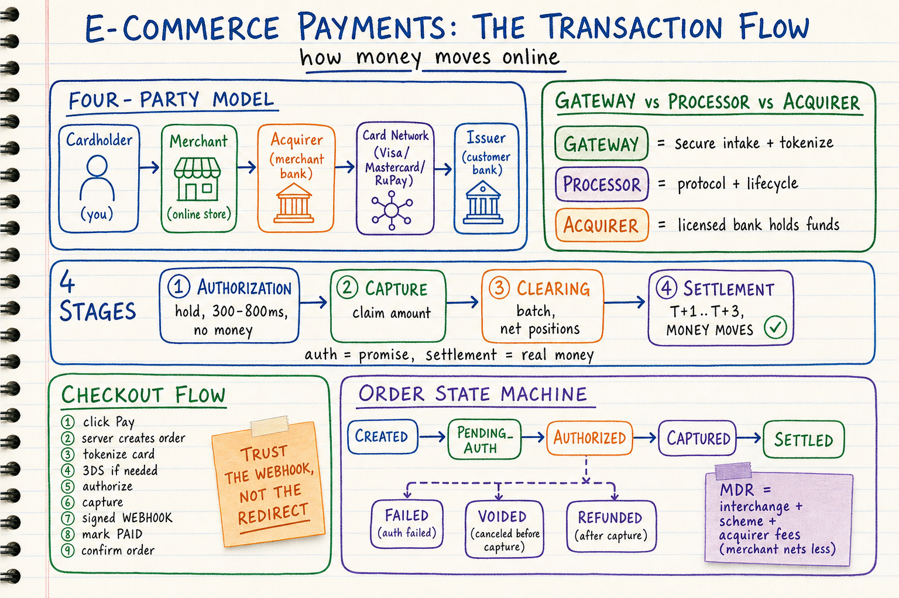
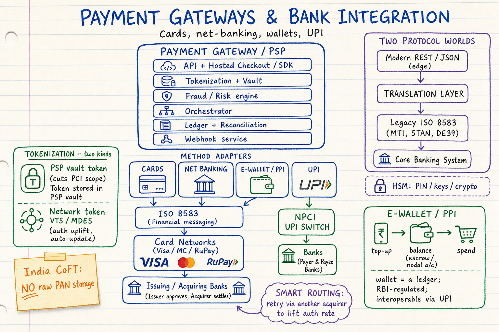
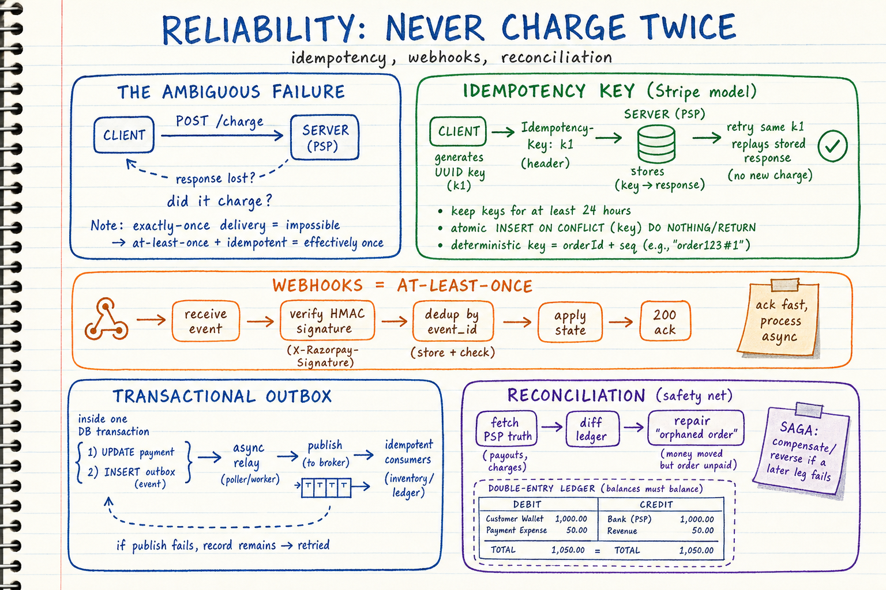
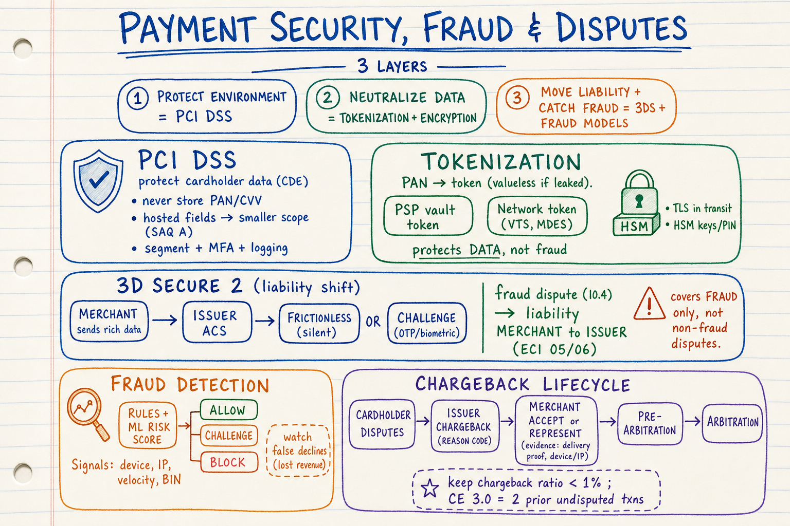
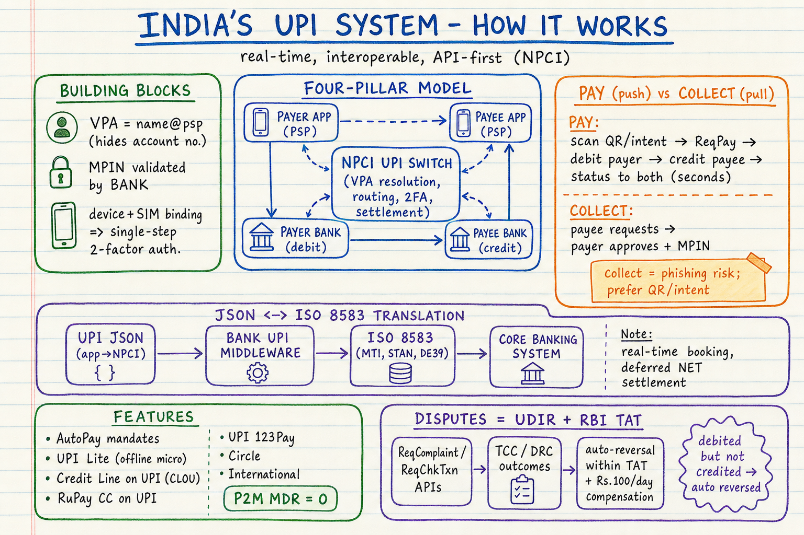

# E-Commerce Payment Systems — Visual Notes

Sketchbook-style visual learning notes for **e-commerce payment systems and payment processors**, based on engineering material from Stripe, Razorpay, PayU, PCI SSC, NPCI, RBI, and card-network/processor documentation.

Each topic has **two parts**:
- a **summary diagram** (`.png`) — the quick, visual sketchbook overview, and
- a **detailed markdown** (`.md`) — the in-depth reference with source links.

| Topic | Summary diagram | Detailed notes |
| --- | --- | --- |
| Payment systems fundamentals & the transaction flow | `payments-fundamentals-transaction-flow-sketchbook.png` | [`01-payment-systems-fundamentals-and-transaction-flow.md`](./01-payment-systems-fundamentals-and-transaction-flow.md) |
| Bank integration, payment gateways & e-wallets | `payment-gateways-bank-integration-sketchbook.png` | [`02-bank-integration-gateways-and-ewallets.md`](./02-bank-integration-gateways-and-ewallets.md) |
| Reliability: idempotency, no double-charging & order confirmation | `payments-reliability-idempotency-sketchbook.png` | [`03-reliability-idempotency-no-double-charging-order-confirmation.md`](./03-reliability-idempotency-no-double-charging-order-confirmation.md) |
| Security, fraud & disputes | `payments-security-fraud-disputes-sketchbook.png` | [`04-security-fraud-and-disputes.md`](./04-security-fraud-and-disputes.md) |
| Indian UPI system — deep dive | `upi-system-architecture-sketchbook.png` | [`05-indian-upi-system-deep-dive.md`](./05-indian-upi-system-deep-dive.md) |

## Diagrams

### 1. Payment Systems Fundamentals & the Transaction Flow

Detailed notes: [`01-payment-systems-fundamentals-and-transaction-flow.md`](./01-payment-systems-fundamentals-and-transaction-flow.md)

Covers:
- **Four-party model**: cardholder, merchant, acquirer, card network, issuer
- **Gateway vs processor vs acquirer** — who does what
- **The four stages**: authorization → capture → clearing → **settlement (T+1..T+3, only stage money moves)**
- End-to-end **checkout flow** and the "trust the webhook, not the redirect" rule
- **Order state machine** and MDR / interchange fee stack

### 2. Bank Integration, Payment Gateways & E-Wallets

Detailed notes: [`02-bank-integration-gateways-and-ewallets.md`](./02-bank-integration-gateways-and-ewallets.md)

Covers:
- **Gateway/PSP architecture**: intake, tokenization/vault, risk, orchestrator, ledger, webhooks
- **Two protocol worlds**: modern REST/JSON edge ⇄ legacy **ISO 8583** (MTI, STAN, DE39) + **HSM**
- **Payment method adapters**: cards, net banking, **e-wallets/PPI**, UPI, EMI/BNPL
- **Tokenization** (PSP vault vs **network tokens** VTS/MDES) and India's **CoFT** no-raw-PAN rule
- **Payment orchestration / smart routing** to lift authorization rates

### 3. Reliability: Idempotency, No Double-Charging & Order Confirmation

Detailed notes: [`03-reliability-idempotency-no-double-charging-order-confirmation.md`](./03-reliability-idempotency-no-double-charging-order-confirmation.md)

Covers:
- The **ambiguous failure** and why **exactly-once delivery is impossible**
- **Idempotency keys** (Stripe model): store & replay, 24h retention, atomic writes, deterministic keys
- **Webhooks are at-least-once** → verify **HMAC** + dedup by event id
- **Transactional outbox** for atomic DB-write + event-publish (Razorpay Outboxer)
- **Saga/compensation** and **reconciliation** as the safety net against orphaned orders

### 4. Security, Fraud & Disputes

Detailed notes: [`04-security-fraud-and-disputes.md`](./04-security-fraud-and-disputes.md)

Covers:
- **PCI DSS** and scope reduction (hosted fields, never store PAN/CVV)
- **Tokenization + encryption/HSM** — making stolen data worthless
- **3D Secure 2**: authentication + **liability shift** (fraud disputes only)
- **Fraud detection** (rules + ML) and the false-decline trade-off
- **Chargeback / dispute lifecycle**: reason codes, representment, CE 3.0, keeping ratio < 1%

### 5. Indian UPI System — Deep Dive

Detailed notes: [`05-indian-upi-system-deep-dive.md`](./05-indian-upi-system-deep-dive.md)

Covers:
- **NPCI four-pillar model** and the **NPCI UPI switch**
- **VPA**, **device+SIM binding + MPIN** = single-step 2-factor auth
- **PAY (push) vs COLLECT (pull)** flows and QR types
- **JSON ⇄ ISO 8583 translation layer** and **deferred net settlement**; **P2M MDR = 0**
- Features: **AutoPay mandates, UPI Lite, Credit Line on UPI, 123Pay, Circle, international**
- **UDIR** dispute framework + **RBI TAT** auto-reversal & compensation

## Style

All diagrams follow the repository's sketchbook visual style. See:
- `docs/sketchbook-style-guide.md`
- `docs/system-design-note-template.md`
