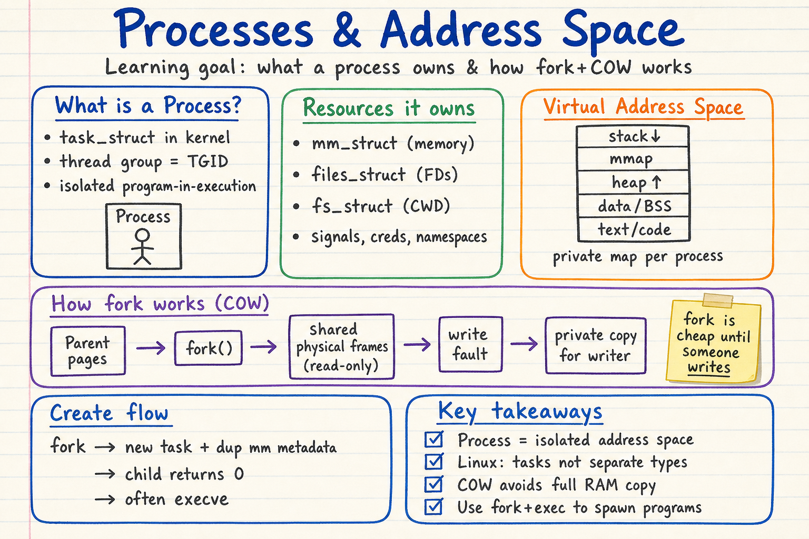
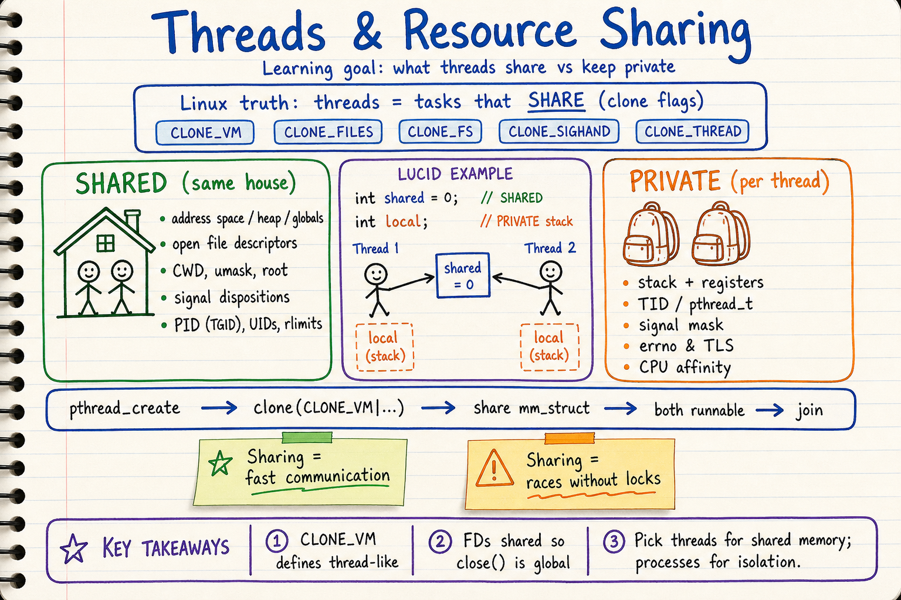
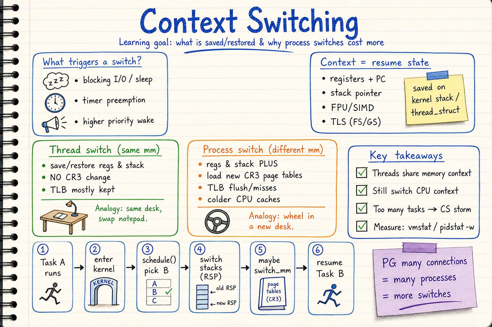
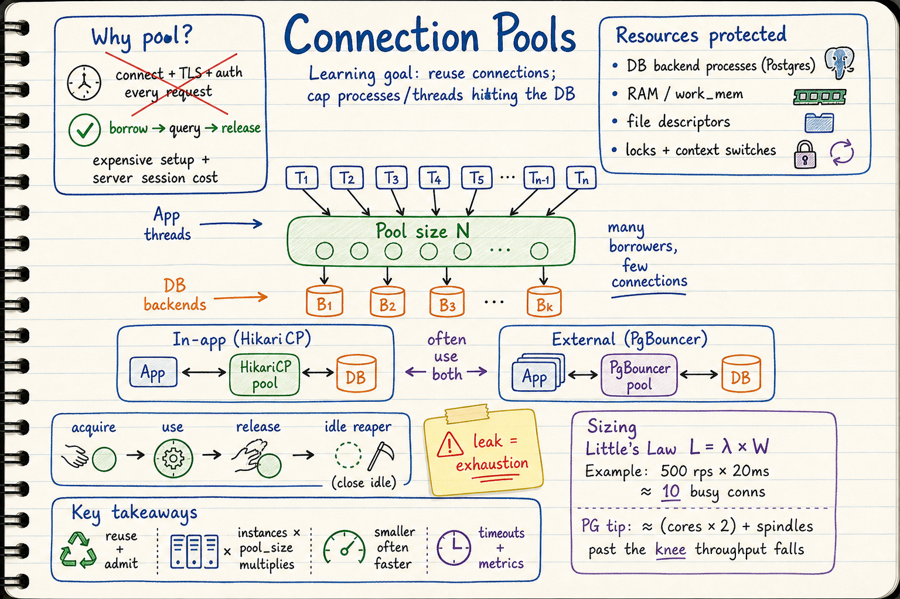

# Processes, Threads & Connection Pools — Visual Notes

Sketchbook-style visual learning notes for **Linux processes & threads**, **memory/resource sharing**, **context switching**, and **connection pools** — sourced from Linux man-pages, kernel internals write-ups, and the PostgreSQL wiki.

Each topic has **two parts**:
- a **summary diagram** (`.png`) — the quick, visual sketchbook overview, and
- a **detailed markdown** (`.md`) — the in-depth reference with source links.

| Topic | Summary diagram | Detailed notes |
| --- | --- | --- |
| Processes & address space | `processes-address-space-sketchbook.png` | [`01-processes-and-address-space.md`](./01-processes-and-address-space.md) |
| Threads & resource sharing | `threads-resource-sharing-sketchbook.png` | [`02-threads-and-resource-sharing.md`](./02-threads-and-resource-sharing.md) |
| Context switching | `context-switching-sketchbook.png` | [`03-context-switching.md`](./03-context-switching.md) |
| Connection pools | `connection-pools-sketchbook.png` | [`04-connection-pools.md`](./04-connection-pools.md) |

## Diagrams

### 1. Processes & Address Space

Detailed notes: [`01-processes-and-address-space.md`](./01-processes-and-address-space.md)

Covers:
- **`task_struct` / thread groups** — Linux treats everything as tasks
- **Resources a process owns** — `mm_struct`, FDs, FS context, signals, creds, namespaces
- **Virtual address space** layout (stack / mmap / heap / data / text)
- **`fork` + copy-on-write** — cheap until a write forces a private page copy

### 2. Threads & Resource Sharing

Detailed notes: [`02-threads-and-resource-sharing.md`](./02-threads-and-resource-sharing.md)

Covers:
- Threads as `clone()` with **`CLONE_VM` / `FILES` / `FS` / `SIGHAND` / `THREAD`**
- **Shared resources:** address space, FDs, CWD, signal dispositions, PID/TGID
- **Private per thread:** stack, registers, signal mask, errno, TLS, TID
- Lucid shared-vs-local example and race-condition caution

### 3. Context Switching

Detailed notes: [`03-context-switching.md`](./03-context-switching.md)

Covers:
- Triggers: blocking, preemption, higher-priority wake
- **What is saved:** registers, stack pointer, FPU/SIMD, TLS
- **Thread switch vs process switch** — same desk vs new desk (CR3 / TLB)
- Link to **connection storms** and measuring with `vmstat` / `pidstat -w`

### 4. Connection Pools

Detailed notes: [`04-connection-pools.md`](./04-connection-pools.md)

Covers:
- Why connect/TLS/auth per request is expensive
- How pools sit between **app threads** and **DB backend processes**
- In-app (**HikariCP**) vs external (**PgBouncer**) — often both
- Sizing with **Little’s Law** and the PostgreSQL “knee”

## Style

All diagrams follow the repository's sketchbook visual style. See:
- `docs/sketchbook-style-guide.md`
- `docs/system-design-note-template.md`
